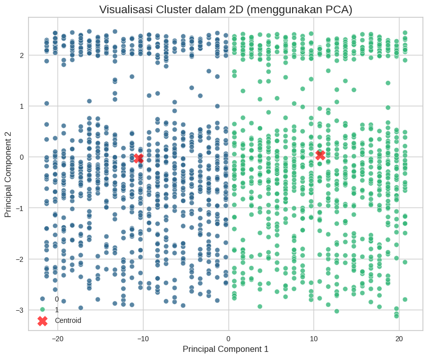
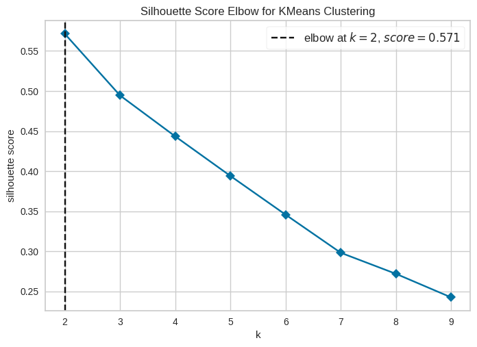

# Bank Transaction Segmentation: Clustering and Classification

[](#getting-started)
[](https://scikit-learn.org/)
[](LICENSE)

A two-stage machine learning project on bank transaction data. First, K-Means clustering (unsupervised) groups 1,945 transactions into segments. Then Decision Tree and Random Forest classifiers (supervised) are trained to predict those segments.

This was the final project of a Dicoding machine learning course. The notebooks are written in Indonesian.

## Results

| Stage | Result |
|---|---|
| Clustering | K-Means with k = 2, silhouette score 0.57. Cluster sizes: 980 and 965 transactions. |
| Classification | Decision Tree, Random Forest, and a tuned Decision Tree all reach 100% accuracy, precision, recall, and F1-score on the test set (389 transactions). |

**These scores should not be read as predictive power.** The cluster labels were created from the same features the classifiers use, and the investigation below shows the clusters are essentially one feature split in two.

## What the Clusters Actually Are

Checking the clusters against the data showed that they are driven by a single feature, the city (`Location`):

- A single split on the encoded city code (codes 0-21 vs 22-42) reproduces the two clusters for all 1,945 transactions.
- Every other feature is almost identical between the two clusters:

| Feature (mean) | Cluster 0 | Cluster 1 |
|---|---|---|
| Transaction amount | 255.55 | 258.15 |
| Customer age | 45.06 | 44.33 |
| Account balance | 5,142.17 | 5,058.81 |
| Transaction duration (s) | 121.12 | 117.30 |

- The occupation mix is also similar: Doctor 270/231, Engineer 237/237, Retired 228/232, and Student 245/265 (cluster 0/cluster 1).

**Why this happened:** `LabelEncoder` turns the 43 city names into codes 0-42 in alphabetical order. Only the numeric features were standardized, so the city code (standard deviation about 12) dominated the distance calculation of K-Means, while the standardized features (standard deviation 1) barely contributed. In the PCA plot below, the first principal component is almost entirely the city code (loading 1.00, 96% of the variance), and the clusters split at zero along it.



Because the clusters only separate "cities A-M" from "cities N-Z" (alphabetically), they do not describe customer segments, and the 100% classification accuracy only shows that the classifier recovered that rule.

## Method

**1. Clustering** (`01_clustering.ipynb`)

- Loaded 2,537 transactions with 16 columns, then removed rows with missing values (18-30 per column) and 21 duplicate rows.
- Dropped ID, IP address, and date columns.
- Encoded categorical features with `LabelEncoder` and standardized numeric features with `StandardScaler`.
- Removed outliers with the IQR rule on the numeric columns, leaving 1,945 transactions.
- Binned customer age into three groups (young, middle-aged, older) and encoded the result.
- Chose k with `KElbowVisualizer` (silhouette metric, k from 2 to 9), then trained K-Means with k = 2.
- Trained a second K-Means model on a 2-component PCA projection for comparison.
- Exported the data with the cluster as the `Target` column, and a version converted back to the original units and categories (`inverse_transform`).



**2. Classification** (`02_classification.ipynb`)

- One-hot encoded the categorical features and split the data 80/20, stratified (1,556 training and 389 test transactions, `random_state=42`).
- Trained a Decision Tree and a Random Forest.
- Tuned a Decision Tree with `GridSearchCV` (5-fold cross-validation). Best parameters: `max_depth=None`, `min_samples_leaf=4`, `min_samples_split=2`, with a cross-validated accuracy of 99.61%.

## Limitations and Possible Improvements

- Scale the encoded categorical features, or use a method designed for mixed data (such as K-Prototypes), so the clustering is not dominated by one feature.
- Encode `Location` in a meaningful way (for example by region) instead of arbitrary alphabetical codes, or leave it out.
- `LoginAttempts` is constant (always 1) after outlier removal, so it adds nothing to the clustering.
- Test several values of k and check that the clusters are stable, and look at clusters with several features contributing before interpreting them as customer segments.
- Evaluate the classifier on labels that are not generated from its own features.

## Project Structure

```
bank-transaction-segmentation
├── 01_clustering.ipynb
├── 02_classification.ipynb
├── data_clustering.csv                       # preprocessed data with the Target (cluster) column
├── data_clustering_inverse.csv               # same data in original units and categories
├── model_clustering.h5                       # K-Means model (k = 2)
├── PCA_model_clustering.h5                   # K-Means model trained on PCA output
├── decision_tree_model.h5
├── explore_random_forest_classification.h5
├── tuning_classification.h5                  # tuned Decision Tree (GridSearchCV)
├── images/
├── requirements.txt
├── LICENSE
└── README.md
```

The `.h5` extension comes from the course requirements. The files are saved with `joblib`, not in HDF5 format. Load them with `joblib.load("model_clustering.h5")`, and only load model files from sources you trust.

## Getting Started

```bash
git clone https://github.com/SidqiRaafi/bank-transaction-segmentation.git
cd bank-transaction-segmentation

python -m venv venv
# Windows: .\venv\Scripts\activate
# macOS/Linux: source venv/bin/activate

pip install -r requirements.txt
jupyter notebook
```

Run `01_clustering.ipynb` first, since `02_classification.ipynb` reads the CSV file it creates. The clustering notebook downloads the dataset from a published Google Sheet, so it needs an internet connection. Both notebooks can also be run in Google Colab.

## Data Source

The dataset is a modified version of the Kaggle dataset "Bank Transaction Dataset for Fraud Detection", provided by the course. Please check the original dataset's license terms before reusing it.

## License

Code: [MIT License](LICENSE).

## Author

Sidqi Raafi Al Fauzan - [GitHub](https://github.com/SidqiRaafi)
